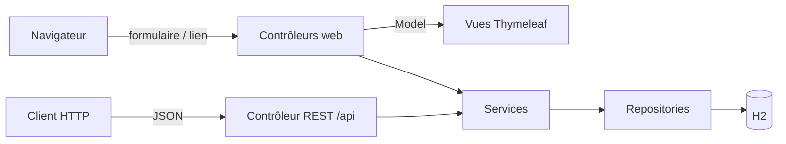

# SAIK — Gestion de voyages étudiants

SAIK est un projet réalisé dans le cadre de la formation **ING2**, pour le
module **JEE**. Cette application web permet de préparer et de suivre des
voyages, leurs transports et leurs dépenses.

## Présentation

L'application propose :

- la création d'un compte, la connexion et la modification du profil ;
- la création, la modification, la suppression et la **recherche** de voyages
  (par nom de voyage, nom de pays ou code ISO), avec un ou plusieurs pays ;
- l'association et la dissociation de pays sur un voyage existant ;
- la gestion des titres de transport (avion, train, VTC/taxi, bus, ferry) :
  création, modification, suppression et filtres ;
- la gestion des dépenses, avec filtres par catégorie, origine et texte ;
- le suivi des budgets par catégorie, avec alerte de dépassement ;
- la création automatique d'une dépense « Transport » pour chaque billet payant,
  tenue à jour quand le prix du billet change ;
- une page de conseils de sécurité et des liens vers des sources officielles ;
- une API REST pour utiliser l'application depuis un client HTTP (par exemple Bruno).

Les réservations externes, le téléversement des pièces jointes et l'envoi
d'alertes ne sont pas connectés.

Pour une analyse du projet et des points restant à vérifier, consulter le
[bilan du projet](./BILAN_PROJET_JEE.md). Le détail de la refonte MVC est décrit
dans [docs/REFONTE-MVC.md](./docs/REFONTE-MVC.md).

## Équipe et cadre du projet

Le projet est porté par l'équipe **SAIK**, dans le cadre du module JEE de la
formation ING2. Membres et répartition des rôles : *à compléter*.

## Technologies

- Java 17
- Spring Boot 4.1.2
- Spring MVC et Thymeleaf pour l'application web
- Spring Data JPA (Hibernate) pour la persistance
- H2 comme base de données embarquée (fichier versionné dans le dépôt)
- Spring Security : sessions et CSRF pour le web, jetons JWT pour l'API, BCrypt
  pour les mots de passe
- Tailwind CSS pour l'interface
- Maven, avec Maven Wrapper

## Prérequis

- Un JDK compatible avec Java 17
- Aucun Maven système requis : le projet fournit le Maven Wrapper

## Lancer le projet

Depuis la racine du dépôt :

```bash
SERVER_PORT=8080 ./mvnw spring-boot:run
```

Ouvrir ensuite [http://localhost:8080](http://localhost:8080).

Le port est défini par la variable `SERVER_PORT`. Sans elle, l'application
utilise le port **81** (`server.port` dans `application.properties`) : sous
Linux et macOS, un port inférieur à 1024 nécessite les droits administrateur,
d'où l'usage de `SERVER_PORT=8080` ci-dessus.

Sous Windows (PowerShell) :

```powershell
$env:SERVER_PORT=8080; .\mvnw.cmd spring-boot:run
```

## Base de données et données de démonstration

La base H2 est un **fichier embarqué dans le dépôt** : `data/saikdb.mv.db`
(URL `jdbc:h2:file:./data/saikdb`). Hibernate crée ou met à jour les tables
à partir des entités Java (`spring.jpa.hibernate.ddl-auto=update`).

Le fichier versionné contient des données de démonstration :

| Compte | Contenu |
|---|---|
| `iris.geyer@email.com` | profil complet, voyages « Chine — Découverte & Aventure » et « Tokyo », un billet et deux dépenses |
| `admin@saik.local` | compte administrateur (`ROLE_ADMIN`), deux voyages, un billet et deux dépenses |

Mots de passe des comptes de démonstration : *à compléter*.

Le fichier de base est modifié à chaque lancement de l'application : éviter de
le commiter sans raison, pour limiter les conflits Git. La console H2 est
désactivée et bloquée.

## Exécuter les tests

```bash
./mvnw test
```

Les tests utilisent une base H2 **en mémoire** : ils ne modifient pas
`data/saikdb.mv.db`. Ils couvrent notamment :

- `WebMvcPagesTests` : parcours complet dans les pages (voyages, recherche, pays,
  billets, dépenses, budgets, profil) ;
- `TravelDataServiceTests` : règles métier des services (pays, billets de vol,
  dépense générée, budgets) ;
- `AuthenticationTests` et `AdminSecurityTests` : inscription, connexion, CSRF,
  jetons JWT, droits d'administration ;
- `IrisDemoTests` : création du compte de démonstration.

## Architecture

L'application suit le modèle **MVC** et une architecture en couches :



- **Contrôleurs web** (`controller/web`) : un contrôleur par page. Chacun place
  ses données dans le `Model` ; les actions sont des formulaires `POST` suivis
  d'une redirection (*Post/Redirect/Get*).
- **Contrôleur REST** (`controller/TravelDataController`) : mêmes fonctionnalités
  en JSON sous `/api`.
- **Services** (`service`) : toute la logique métier et les contrôles d'accès,
  partagés par le web et l'API.
- **Repositories** (`repository`) : accès à la base avec Spring Data JPA.
- **Entités** (`model`) : tables et relations JPA.

```text
src/main/java/projet/saik/
├── config/            # Initialisation des données, sécurité
├── controller/        # Contrôleurs REST (API, authentification, administration)
│   └── web/           # Contrôleurs des pages Thymeleaf
├── model/             # Entités JPA
├── repository/        # Repositories Spring Data JPA
├── security/          # Chargement des comptes, blocage des connexions
├── service/           # Logique métier
└── web/               # DTO de l'API, objets de vue et de formulaire
src/main/resources/
├── static/            # CSS et JavaScript (comportements d'interface)
├── templates/         # Vues Thymeleaf
│   └── fragments/     # En-tête, navigation, champs de formulaire partagés
└── application.properties
src/test/java/projet/saik/   # Tests
```

### Services

| Service | Rôle |
|---|---|
| `AccessService` | Identifie la personne connectée (session ou JWT) et vérifie qu'un voyage lui appartient |
| `TripService` | Voyages, pays associés, recherche |
| `TicketService` | Billets, détails de vol, dépense générée automatiquement |
| `BudgetService` | Budgets par catégorie et dépenses |
| `ProfileService` | Profil et changement d'adresse e-mail |
| `AccountService`, `AdminService` | Inscription, administration des comptes |

## Modèle de données

Huit entités JPA, plus les détails de vol intégrés au billet (`@Embeddable`) :

| Relation | Type | Description |
|---|---|---|
| `Trip` ↔ `Budget` | **1-1** | Chaque voyage a un budget, créé en même temps que lui |
| `TransportTicket` ↔ `Expense` | **1-1** | Un billet payant génère une dépense « Transport » |
| `User` → `Trip` | **1-N** | Un compte possède plusieurs voyages |
| `Trip` → `TransportTicket` | **1-N** | Un voyage contient plusieurs billets |
| `Budget` → `Expense` | **1-N** | Un budget regroupe plusieurs dépenses |
| `Trip` ↔ `Country` | **N-N** | Un voyage visite plusieurs pays ; un pays apparaît dans plusieurs voyages |
| `User` ↔ `Role` | **N-N** | Rôles de sécurité des comptes |
| `Role` ↔ `Permission` | **N-N** | Permissions accordées à chaque rôle |

La suppression d'un voyage entraîne celle de son budget, de ses billets et de ses
dépenses (cascade JPA).

## Pages de l'application

| Page | Route | Fonctionnalités |
|---|---|---|
| Accueil | `/`, `/accueil` | Présentation, accès à la connexion et à l'inscription |
| Tableau de bord | `/`, `/dashboard` | Voyage sélectionné et compte à rebours, liste des voyages, recherche, filtres par statut, création / modification / suppression, ajout et retrait de pays |
| Transports | `/transports` | Billets du voyage sélectionné, création / modification / suppression, filtres par type |
| Budget | `/budget` | Indicateurs, répartition des dépenses, budgets par catégorie, registre des dépenses filtrable, export CSV |
| Sécurité | `/securite` | Conseils et liens officiels pour le voyage sélectionné |
| Profil | `/profil` | Informations personnelles, âge calculé, export JSON des données |

Le voyage sélectionné est mémorisé dans la session et se change depuis l'en-tête.

## Logique métier

- **Dépense automatique** : un billet dont le prix est supérieur à zéro crée une
  dépense « Transport » du même montant, à la date de départ. Si le prix change,
  la dépense est mise à jour ; s'il revient à zéro ou si le billet est supprimé,
  elle est retirée du budget.
- **Budgets** : chaque catégorie peut avoir un budget ; les montants dépensés,
  restants et les dépassements sont calculés et signalés.
- **Vols** : vérification des codes IATA, du PNR (6 caractères), du numéro de
  billet (13 chiffres) et des décalages UTC ; calcul de la durée réelle du vol.
- **Voyages** : la date de fin ne peut pas précéder le début ; au moins un pays
  est requis ; statut (actif, futur, archivé) et compte à rebours calculés.
- **Recherche** : requête JPQL avec jointure sur la relation N-N `Trip ↔ Country`.
- **Accès** : chaque compte ne voit et ne modifie que ses propres données.

## API REST

Les routes `/api/...` acceptent un jeton `Authorization: Bearer <token>` (voir
[Authentification](#authentification)).

| Fonction | Routes |
|---|---|
| Lister et créer des voyages | `GET`, `POST /api/trips` |
| Modifier et supprimer un voyage | `PUT`, `DELETE /api/trips/{tripId}` |
| Ajouter ou retirer un pays | `POST /api/trips/{tripId}/countries`, `DELETE /api/trips/{tripId}/countries/{iso}` |
| Lister et ajouter des billets | `GET`, `POST /api/trips/{tripId}/tickets` |
| Modifier et supprimer un billet | `PUT`, `DELETE /api/tickets/{ticketId}` |
| Consulter et modifier le budget | `GET`, `PUT /api/trips/{tripId}/budget` |
| Lister et ajouter des dépenses | `GET`, `POST /api/trips/{tripId}/expenses` |
| Supprimer une dépense | `DELETE /api/expenses/{expenseId}` |
| Consulter et modifier le profil | `GET`, `PUT /api/profile` |
| Administration des comptes | `GET /api/admin/users`, `DELETE /api/admin/users/{id}` |

Les billets acceptent, en plus des champs communs, `flightDetails` pour un vol,
ou `operatorName`, `serviceNumber` et `seatInfo` pour un train, un VTC/taxi,
un bus ou un ferry.

## Authentification

Créer un compte sur `/register`, puis se connecter sur `/login` avec son e-mail
et son mot de passe. L'adresse e-mail est normalisée en minuscules ; le mot
de passe doit contenir au moins 8 caractères et au plus 72 octets. Il est
enregistré sous forme d'empreinte BCrypt. Les pages et données de voyage
nécessitent une connexion ; chaque compte ne peut accéder qu'à ses propres
voyages, billets, dépenses et profil. La déconnexion est disponible dans
l'en-tête. Les formulaires et la déconnexion sont protégés contre les attaques
CSRF.

L'API propose également des routes d'authentification :

- `POST /api/v1/auth/register` accepte `{"firstName":"...","lastName":"...","email":"...","password":"..."}`.
- `POST /api/v1/auth/login` accepte les mêmes champs et retourne un jeton
  `Bearer` (`token`, `type`, `expiresInSeconds`).
- Pour les autres routes `/api/...`, transmettre ce jeton dans l'en-tête
  `Authorization: Bearer <token>` ; l'interface web utilise quant à elle une
  session et un jeton CSRF.

La durée de validité par défaut du jeton est de 60 minutes, configurable via
`APP_JWT_EXPIRATION_MINUTES`. Pour conserver les jetons après un redémarrage,
définir `APP_JWT_SECRET` avec un secret aléatoire d'au moins 32 octets, gardé
hors du dépôt. Sans cette variable, une clé aléatoire temporaire est générée
au démarrage et les jetons expirent au redémarrage. La déconnexion web invalide
la session, mais ne révoque pas les jetons API déjà émis.

Pour une base existante contenant l'ancien compte de démonstration,
sauvegarder d'abord `data/saikdb.mv.db`, puis définir la variable
`SAIK_LEGACY_DEMO_PASSWORD` avec un **nouveau** mot de passe conforme avant le
premier démarrage. L'ancien mot de passe de démonstration est remplacé par une
empreinte BCrypt ; les données existantes restent associées au compte. Le
démarrage échoue explicitement tant que ce nouveau mot de passe n'est pas
fourni. Une fois la migration réussie, retirer cette variable. Les autres mots
de passe historiques en clair sont également convertis en BCrypt au démarrage.

### Compte de démonstration Iris (base neuve)

Le fichier de base versionné contient déjà ce compte. Sur une base **neuve**,
on peut le créer volontairement en définissant un mot de passe personnel d'au
moins 8 caractères et de 72 octets maximum dans `SAIK_IRIS_DEMO_PASSWORD`, puis
en démarrant l'application. Par exemple :

```bash
read -rs -p "Mot de passe du compte Iris : " SAIK_IRIS_DEMO_PASSWORD; echo
export SAIK_IRIS_DEMO_PASSWORD
SERVER_PORT=8080 ./mvnw spring-boot:run
```

Le compte utilise l'adresse fictive `iris.geyer@email.com` et le mot de passe
choisi, stocké avec BCrypt. Son profil et le voyage « Chine — Découverte &
Aventure », du 1er au 21 mars 2027, sont enregistrés avec un budget vide ;
aucun billet ni dépense n'est créé.

**Réinitialiser le mot de passe du compte Iris** (ses voyages, billets et
dépenses sont conservés) : définir `SAIK_IRIS_RESET_PASSWORD` (8 caractères
minimum, 72 octets maximum), démarrer l'application une fois, puis retirer la
variable.

```bash
read -rs -p "Nouveau mot de passe Iris : " SAIK_IRIS_RESET_PASSWORD; echo
export SAIK_IRIS_RESET_PASSWORD
SERVER_PORT=8081 ./mvnw spring-boot:run
# après le démarrage : arrêter l'application, puis
unset SAIK_IRIS_RESET_PASSWORD
```

La création est facultative et ne se produit qu'au démarrage lorsque la variable
est renseignée. Si un compte avec cette adresse existe déjà, il n'est jamais
modifié et son mot de passe n'est pas réinitialisé. Après création, retirer la
variable de l'environnement pour éviter de recréer le compte s'il est supprimé.

### Administration et sécurité

- **Premier administrateur** : définir `SAIK_ADMIN_EMAIL` et `SAIK_ADMIN_PASSWORD`
  (8 caractères minimum, 72 octets maximum) avant le démarrage. Le compte est créé
  avec le rôle `ROLE_ADMIN` (prénom « Administrateur », nom « SAIK ») ; s'il existe
  déjà, le rôle lui est ajouté sans changer son mot de passe. Sans `SAIK_ADMIN_EMAIL`,
  aucun administrateur n'est créé. Retirer `SAIK_ADMIN_PASSWORD` de l'environnement
  une fois le compte créé.
- **Routes d'administration** (session web ou jeton `Bearer`, rôle `ROLE_ADMIN`) :
  `GET /api/admin/users` liste les comptes (sans mot de passe) ;
  `DELETE /api/admin/users/{id}` supprime un compte avec ses voyages et exige la
  permission `USER_DELETE`. Un administrateur ne peut pas supprimer son propre compte.
  Les routes sont protégées par l'URL (`SecurityConfig`) et par `@PreAuthorize`.
- **Rôles et permissions** : les rôles (`ROLE_…`) et leurs permissions (`TRIP_READ`,
  `TRIP_WRITE`, `USER_DELETE`) sont transmis comme autorisations Spring Security,
  y compris dans les claims `roles` et `permissions` du jeton JWT.
- **Blocage des connexions** : après `SAIK_MAX_LOGIN_ATTEMPTS` échecs (5 par défaut)
  sur une adresse, la connexion est refusée pendant `SAIK_LOCKOUT_MINUTES` minutes
  (15 par défaut), sur le formulaire web comme sur l'API. Le compteur est en mémoire
  et repart de zéro au redémarrage.
- **Changement d'adresse e-mail** : le mot de passe actuel est exigé lorsque
  l'adresse change (page profil et `PUT /api/profile`, champ `currentPassword`).
- **Cookie de session** : `HttpOnly` et `SameSite=Lax`. Définir `SAIK_COOKIE_SECURE=true`
  lorsque l'application est servie en HTTPS.
- `SAIK_SHOW_SQL=true` réactive l'affichage des requêtes SQL en développement.

Avant une mise en production, il faudrait notamment servir l'application en
HTTPS, gérer les secrets hors du dépôt et ajouter une procédure sécurisée de
réinitialisation des mots de passe.

## Limites connues

- Les réservations auprès de partenaires ne sont pas connectées ; certains
  boutons de démonstration l'indiquent explicitement.
- Les pièces jointes (billets, reçus) ne conservent que leur nom de fichier :
  elles ne sont pas téléversées.
- La page de sécurité renvoie vers les conseils officiels : elle ne fournit pas
  de numéros d'urgence par destination et ne transmet aucune alerte.
- L'âge du profil est calculé à partir d'une date de naissance au format
  `AAAA-MM-JJ` ou `5 mars 2005`.
