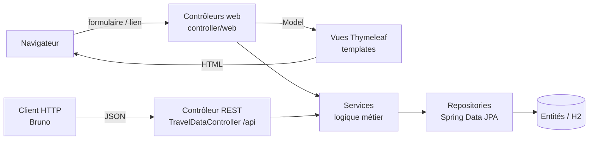

# Refonte MVC de SAIK — documentation des modifications

Ce document décrit **tout ce qui a été modifié** depuis le commit `71f9e52`
(« H2 embarquée : base fichier versionnée avec données de démo ») : pourquoi,
comment, dans quels fichiers, et comment le vérifier.

Il s'adresse aux membres de l'équipe qui n'ont pas suivi la refonte et qui
doivent pouvoir expliquer le code à la soutenance.

---

## Sommaire

1. [Pourquoi cette refonte](#1-pourquoi-cette-refonte)
2. [Architecture finale](#2-architecture-finale)
3. [Étape A : passage au MVC (pages rendues par les contrôleurs)](#3-étape-a--passage-au-mvc)
4. [Étape B : découpage de TravelDataService](#4-étape-b--découpage-de-traveldataservice)
5. [Étape C : recherche de voyages en base](#5-étape-c--recherche-de-voyages-en-base)
6. [Étape D : suppression des doublons et correction d'un bug](#6-étape-d--suppression-des-doublons-et-correction-dun-bug)
7. [Étape E : création et modification des billets en MVC](#7-étape-e--création-et-modification-des-billets-en-mvc)
8. [Étape F : nettoyage du front](#8-étape-f--nettoyage-du-front)
9. [Référence : toutes les routes des pages](#9-référence--toutes-les-routes-des-pages)
10. [Changements visibles pour l'API REST](#10-changements-visibles-pour-lapi-rest)
11. [Tests](#11-tests)
12. [Liste complète des fichiers](#12-liste-complète-des-fichiers)
13. [Points d'attention](#13-points-dattention)

---

## 1. Pourquoi cette refonte

La grille d'évaluation demande notamment :

- *« l'application utilise le design pattern MVC pour chaque fonctionnalité »* ;
- *« chaque vue manipule des données transmises par son contrôleur »* ;
- *« l'application permet d'insérer, mettre à jour, supprimer, **chercher** une entité en BDD »*.

**Avant la refonte**, l'interface fonctionnait comme une application JavaScript :

- `PageController` renvoyait uniquement le nom du template, **sans aucune donnée** ;
- chaque page arrivait vide, puis le JavaScript appelait l'API REST (`/api/trips`,
  `/api/trips/{id}/tickets`…) et construisait le HTML lui-même (≈ 1 950 lignes de JS) ;
- le voyage sélectionné était mémorisé dans le navigateur (`sessionStorage`) ;
- aucune recherche n'existait.

Un correcteur aurait donc vu « une API + du JavaScript », pas du MVC Thymeleaf.

**Après la refonte** :

- chaque page a **son contrôleur**, qui place les données dans le `Model` ;
- les templates les affichent avec `th:each`, `th:text`, `th:field` ;
- chaque action (créer, modifier, supprimer, associer, rechercher) est un **formulaire**
  envoyé au contrôleur, qui appelle un **service** puis redirige ;
- le JavaScript ne gère plus que l'interface (≈ 500 lignes : fenêtres, lignes de
  formulaire, filtres, exports) ;
- l'API REST est **conservée** et utilise **les mêmes services**.

---

## 2. Architecture finale



| Couche | Paquet | Rôle |
|---|---|---|
| Contrôleurs web | `controller/web` | Reçoivent les requêtes des pages, remplissent le `Model`, choisissent la vue. Ne contiennent pas de logique métier. |
| Contrôleur REST | `controller` (`TravelDataController`) | Même chose en JSON pour l'API `/api/...`. |
| Services | `service` | **Toute** la logique métier et les contrôles d'accès. Partagés par le web et l'API. |
| Repositories | `repository` | Accès à la base (Spring Data JPA, requêtes JPQL). |
| Entités | `model` | Tables et relations JPA. |
| Objets d'échange | `web` | DTO de l'API (`TravelDataDtos`), objets de vue (`TripView`, `BudgetView`) et objet de formulaire (`TicketForm`). |

**Règle suivie partout** : un contrôleur est « fin ». Il lit la requête, appelle
un service, met le résultat dans le modèle (ou redirige). Une même règle métier
n'est écrite qu'une seule fois, dans le service.

### Exemple de parcours complet (ajout d'un pays à un voyage)

1. L'utilisateur remplit « Ajouter un pays » sur le tableau de bord → `POST /dashboard/trips/12/countries`.
2. `DashboardController.addCountry` valide la saisie et appelle `TripService.addCountry`.
3. `TripService` vérifie que le voyage appartient à l'utilisateur (`AccessService.requireOwnedTrip`),
   réutilise le pays s'il existe déjà, l'ajoute à la relation N-N et enregistre.
4. Le contrôleur ajoute un message flash (« Italie ajouté au voyage. ») et redirige vers `/dashboard`.
5. `GET /dashboard` : le contrôleur remet les voyages dans le modèle, la vue affiche le nouveau pays.

Ce schéma **POST → service → redirection → GET** (dit *Post/Redirect/Get*) évite
qu'un rafraîchissement de la page renvoie le formulaire une seconde fois.

---

## 3. Étape A : passage au MVC

### 3.1 Un contrôleur par page (`controller/web`)

| Contrôleur | Page | Données mises dans le modèle |
|---|---|---|
| `DashboardController` | `/`, `/dashboard` | voyages filtrés, compteurs par statut, voyage à modifier, résultats de recherche |
| `TransportController` | `/transports` | billets du voyage sélectionné, total, formulaire de billet |
| `BudgetController` | `/budget` | budget calculé (`BudgetView`), dépenses filtrées, catégories |
| `ProfilController` | `/profil` | profil, âge calculé |
| `PageController` | `/accueil`, `/securite` | aucune donnée propre (l'en-tête reçoit le voyage sélectionné) |
| `TripSelectionController` | `POST /trips/select` | change le voyage sélectionné |

`PageController` a été **déplacé** de `controller` vers `controller/web` et réduit :
la route `/` est maintenant gérée par `DashboardController` (affiche l'accueil si
la personne n'est pas connectée, le tableau de bord sinon).

### 3.2 Données communes à toutes les pages : `LayoutAdvice`

`LayoutAdvice` est un `@ControllerAdvice` limité au paquet `controller/web`.
Sa méthode `@ModelAttribute` s'exécute **avant chaque contrôleur de page** et ajoute :

- `trips` : tous les voyages de l'utilisateur (sous forme de `TripView`) ;
- `selectedTrip` : le voyage sélectionné ;
- `currentPath` : l'adresse de la page (pour revenir au bon endroit après une sélection).

Si le compte est introuvable (cas des tests avec un faux utilisateur), la page
s'affiche simplement sans voyage.

> Le fichier existait déjà (début de travail d'Ambre) mais ne s'appliquait à
> aucun contrôleur, car le paquet `controller/web` n'en contenait pas. Il est
> maintenant actif.

### 3.3 Voyage sélectionné en session

Avant : `sessionStorage` du navigateur (invisible pour le serveur).
Maintenant : attribut `selectedTripId` de la **session HTTP**.

- `SelectedTripResolver` (existant) retrouve le voyage sélectionné, ou prend le premier ;
- `TripSelectionController` (`POST /trips/select`) le change, après avoir vérifié que
  le voyage appartient à l'utilisateur. Le paramètre `returnTo` n'accepte que les
  pages de l'application (pas de redirection vers un site extérieur) ;
- l'en-tête contient une liste déroulante qui envoie ce formulaire dès qu'on change de voyage ;
- créer un voyage le sélectionne automatiquement.

### 3.4 Objets de vue (paquet `web`)

Les calculs d'affichage sont faits **en Java**, plus en JavaScript :

- **`TripView`** : un voyage + son statut (`Actif`, `Futur`, `Archivé`), son libellé,
  son icône, sa durée en jours, et le compte à rebours (« Départ dans 12 jours »,
  « Voyage terminé depuis 3 jours », « Dernier jour du séjour »…).
- **`BudgetView`** : totaux (budget défini, dépensé, restant), dépassement global,
  et pour chaque catégorie : montant dépensé, budget, dépassement, part du
  diagramme circulaire et largeur de la barre. La liste des catégories
  (`Transport`, `Hébergement`, `Formalités`, `Activités`, `Restauration`, `Tech`)
  et leurs couleurs y sont définies **une seule fois**.

### 3.5 Outils partagés des contrôleurs : `WebActions`

- `run(flash, message, action)` : exécute une action du service ; en cas de succès,
  ajoute le message de confirmation, sinon le message d'erreur du service ;
- `validate(objet)` : applique les annotations de validation des DTO (`@NotBlank`,
  `@Pattern`…), comme `@Valid` le fait pour l'API ;
- `errorMessage(exception)` : transforme une erreur en message lisible.

Les messages (confirmation ou erreur) s'affichent en bas à droite grâce au
fragment `flash` de `layout.html`, puis disparaissent après 5 secondes.

### 3.6 Templates

| Template | Avant | Après |
|---|---|---|
| `dashboard.html` | Conteneurs vides remplis par `trips.js` | Voyages rendus avec `th:each`, filtres par statut (liens GET), formulaires de création / modification / suppression, ajout et retrait de pays (N-N), sélection |
| `budget.html` | Tableau et diagrammes construits en JS | Indicateurs, diagramme SVG, barres par catégorie, tableau des dépenses, filtres (formulaire GET), formulaires d'ajout / suppression et de budgets par catégorie |
| `transports.html` | Billets construits par `transports.js` | Cartes de billets rendues par Thymeleaf, suppression par formulaire (et, étape E, création / modification) |
| `profil.html` | Champs remplis puis envoyés par `profile.js` | Champs pré-remplis avec `th:value`, envoi `POST /profil` |
| `securite.html` | Voyage sélectionné écrit par le JS | Voyage sélectionné affiché par Thymeleaf |
| `fragments/layout.html` | En-tête statique | Sélecteur de voyage, bouton « Nouveau voyage » (lien), bouton « Déconnexion » (vrai formulaire avec jeton CSRF), fragment `flash` |

Les formulaires utilisent `th:action` : Thymeleaf y ajoute automatiquement le
**jeton CSRF** exigé par Spring Security.

---

## 4. Étape B : découpage de `TravelDataService`

`TravelDataService` (667 lignes) mélangeait voyages, billets, budget, profil et
contrôles d'accès. Il a été **supprimé** et son code **déplacé, sans réécriture**,
dans cinq services :

| Service | Contenu |
|---|---|
| `AccessService` | `requireCurrentUser()` (qui est connecté, par session ou par jeton JWT), `requireOwnedTrip(id)` (le voyage existe **et** appartient à l'utilisateur, sinon 404), `requireBudget(trip)` |
| `TripService` | voyages (CRUD), ajout / retrait de pays, recherche |
| `TicketService` | billets et détails de vol, dépense générée automatiquement |
| `BudgetService` | budget par catégorie, dépenses |
| `ProfileService` | profil, vérification du mot de passe actuel avant un changement d'e-mail |

Avant, les contrôles d'accès étaient des méthodes privées ; ils sont maintenant
dans `AccessService`, utilisé par tous les autres services (`access.requireOwnedTrip(...)`).

Chaque contrôleur reçoit uniquement les services dont il a besoin
(`BudgetController` → `BudgetService`, etc.). `TravelDataController` (API) reçoit
les quatre.

---

## 5. Étape C : recherche de voyages en base

Répond au critère « chercher une entité en BDD ».

**Repository** — `TripRepository.searchByUser(userId, query)`, requête JPQL :

```sql
SELECT DISTINCT t FROM Trip t LEFT JOIN t.countries c
WHERE t.user.id = :userId
  AND (LOWER(t.name)    LIKE LOWER(CONCAT('%', :query, '%'))
    OR LOWER(c.name)    LIKE LOWER(CONCAT('%', :query, '%'))
    OR LOWER(c.codeIso) LIKE LOWER(CONCAT('%', :query, '%')))
ORDER BY t.startDate ASC
```

- cherche dans le **nom du voyage**, le **nom des pays** et leur **code ISO** ;
- parcourt la relation **N-N** `Trip ↔ Country` grâce à la jointure ;
- ne renvoie que les voyages de l'utilisateur connecté ;
- ignore les majuscules / minuscules ; `DISTINCT` évite qu'un voyage à plusieurs pays apparaisse plusieurs fois.

**Service** — `TripService.searchTrips(query)` : une recherche vide renvoie tous les voyages.

**Contrôleur** — `GET /dashboard?q=...` : les résultats remplacent la liste ; les
compteurs et les onglets Actif / Futur / Archivé portent sur les résultats, et
changer d'onglet conserve la recherche.

**Vue** — barre de recherche, nombre de résultats, bouton « Effacer », message
« Aucun voyage ne correspond à votre recherche ».

Le registre des dépenses (`/budget`) dispose aussi de filtres côté serveur :
catégorie, origine (automatique / manuelle) et texte.

---

## 6. Étape D : suppression des doublons et correction d'un bug

Les méthodes publiques gardent **le même nom et les mêmes paramètres** : rien ne
change pour les contrôleurs ni pour l'API. Seul le code dupliqué à l'intérieur a
été regroupé dans des méthodes privées.

### `TripService`

`createTrip` et `updateTrip` recopiaient la vérification des dates et toute la
gestion des pays. Elles appellent maintenant :

- `validateDates(request)` : la fin ne peut pas précéder le début ;
- `applyRequest(trip, request)` : nom, dates, et remplacement des pays (au moins
  un pays, réutilisation des pays existants, codes ISO en double ignorés).

### `TicketService`

`createTicket` et `updateTicket` recopiaient la copie des champs et la gestion du vol ;
`updateTicket` et `deleteTicket` recopiaient « chercher le billet + vérifier le propriétaire ».
Nouvelles méthodes privées :

- `requireOwnedTicket(id)` ;
- `applyRequest(ticket, request)` ;
- `syncGeneratedExpense(ticket)`.

### Bug corrigé dans `updateTicket`

`updateTicket` (ajouté par Killian) ne mettait à jour la dépense générée **que si
elle existait déjà** :

| Cas | Avant | Après |
|---|---|---|
| Billet à 0 € passé à 50 € | aucune dépense créée | dépense « Transport » de 50 € créée |
| Billet à 50 € passé à 80 € | dépense mise à jour | dépense mise à jour |
| Billet à 50 € passé à 0 € | dépense conservée à 0 € | dépense supprimée du budget |

La règle métier est maintenant écrite une seule fois dans `syncGeneratedExpense`,
utilisée à la création **et** à la modification : *un billet payant a toujours
une dépense « Transport » de même montant, à la date de départ.*

---

## 7. Étape E : création et modification des billets en MVC

### 7.1 Trois nouvelles informations pour les transports terrestres

Le formulaire proposait déjà, pour Train / VTC-Taxi / Bus / Ferry, trois champs
(opérateur, numéro, place), mais ils étaient **collés dans la description**
(« Paris → Lyon · SNCF · TGV 6611 · Voiture 12 ») et ne pouvaient pas être
retrouvés pour une modification. Ils sont devenus de vraies colonnes :

| Champ Java (`TransportTicket`) | Colonne | Exemple train | Exemple taxi |
|---|---|---|---|
| `operatorName` | `operator_name` | SNCF | Nom du chauffeur |
| `serviceNumber` | `service_number` | TGV 6611 | Référence de course |
| `seatInfo` | `seat_info` | Voiture 12, place 45 | Instructions de prise en charge |

- Avec `spring.jpa.hibernate.ddl-auto=update`, H2 ajoute ces colonnes
  automatiquement au prochain démarrage ; les billets existants ont ces champs vides.
- Pour un vol, ils restent vides (la compagnie est dans les détails du vol).

### 7.2 L'objet de formulaire `TicketForm`

`TicketForm` (paquet `web`) est l'objet que Spring MVC remplit à partir du
formulaire (*form backing bean*) grâce à `th:object="${ticketForm}"` et
`th:field="*{...}"`. Les champs du vol sont dans un sous-objet : `flight.airline`,
`flight.departureIata`…

- `toRequest()` : formulaire → `TicketRequest` pour le service ;
- `from(ticket)` : billet enregistré → formulaire pré-rempli (modification) ;
- `CHOICES` : les listes de choix du vol (tarif, bagages, conditions, siège, repas),
  définies une seule fois ;
- les champs date-heure utilisent le format `yyyy-MM-dd'T'HH:mm` envoyé par
  `<input type="datetime-local">`.

Pourquoi un objet de formulaire plutôt que l'entité directement ? L'entité
contient des relations (voyage, dépense) qu'un formulaire ne doit pas pouvoir
modifier, et le formulaire a une forme différente (sous-objet `flight`, champs
selon le type).

### 7.3 `TransportController`

| Route | Rôle |
|---|---|
| `GET /transports` | liste des billets ; formulaire vide prêt pour la création |
| `GET /transports?edit={id}` | ouvre le formulaire pré-rempli avec le billet |
| `POST /transports/tickets` | crée le billet sur le voyage sélectionné (`TicketService.createTicket`) |
| `POST /transports/tickets/{id}` | modifie le billet (`TicketService.updateTicket`) |
| `POST /transports/tickets/{id}/delete` | supprime le billet et sa dépense générée |

En cas d'erreur (PNR manquant, horaires incohérents…), le contrôleur **ne redirige
pas** : il réaffiche la page avec le formulaire ouvert, les valeurs saisies et le
message d'erreur, pour ne pas perdre la saisie du long formulaire de vol.
`create` et `update` partagent la méthode privée `save(...)`.

### 7.4 Vue

- `fragments/forms.html` (nouveau) : deux fragments réutilisables,
  `input(label, path, type, placeholder, required)` et
  `select(label, path, choices, required)`. Le formulaire de billet les utilise
  une trentaine de fois au lieu de recopier le même HTML.
- `transports.html` : formulaire Thymeleaf complet (type, description, bloc vol,
  bloc trajet terrestre, prix, référence, horaires, justificatif) ; bouton
  **« Modifier »** sur chaque carte ; les cartes affichent opérateur, numéro et place.
- `transports.js` : affiche le bloc vol ou le bloc terrestre selon le type (le bloc
  masqué est désactivé, donc ni validé ni envoyé), adapte les libellés (« Gare de
  départ » pour un train, « Port de départ » pour un ferry…), affiche un aperçu
  de la durée du vol, recopie le nom du justificatif dans le champ caché
  `attachmentName` (le fichier lui-même n'est pas téléversé).

La création de billet ne passe plus par l'API en JavaScript : c'était la dernière
exception au MVC.

---

## 8. Étape F : nettoyage du front

- **`<head>` commun** : le même `<head>` (polices, Tailwind, `design-tokens.js`,
  `design.css`, `travel-app.js`) était recopié dans 5 pages. Il est maintenant
  le fragment `head(title)` de `layout.html` ; chaque page n'a plus qu'une ligne :
  `<head th:replace="~{fragments/layout :: head('Mon profil')}"></head>`.
- **Code JavaScript mort supprimé** (il visait des éléments absents des pages) :
  - `travel-app.js` : gestion de « Rechercher billet », « Ouvrir GPS »,
    « Télécharger Certificat », « Notifications », liens `#`, interception de
    `alert(...)`, réécriture des liens du menu et du titre (déjà faits par Thymeleaf) ;
  - `transports.js` : boutons « carte d'embarquement », « QR », « Scanner porte »,
    « Détails / Options », « Rechercher via API » ;
  - `profile.js` : `revokeSessions`, `showPasswordToast` ;
  - `common.js` : `createTextElement` ;
  - `trips.js` : `requireSelectedTripId` (le voyage sélectionné est connu du serveur).
- **Filtres des billets** (Tous / Vols / Trains / Taxis & Navettes) : basés sur le
  vrai type du billet (`data-transport-type`) au lieu de rechercher des mots dans le texte.
- **Conservés volontairement** : les boutons de démonstration non reliés et
  l'onglet « Réservations externes », avec le message « non relié à un service
  externe » (`initializeUnwiredButtons`).

### Rôle de chaque fichier JavaScript après la refonte

| Fichier | Rôle |
|---|---|
| `travel-app.js` | Point d'entrée : menu latéral sur mobile, masquage du message flash, appel des initialisations de chaque page |
| `common.js` | `announce` (message temporaire), `apiRequest` (utilisé par l'export JSON), `downloadFile` |
| `trips.js` | Lignes « pays » du formulaire de voyage, confirmation avant suppression (`data-confirm`) |
| `transports.js` | Formulaire de billet (type, libellés, escales, durée, justificatif), filtres |
| `budget.js` | Ouverture des fenêtres, export CSV, nom du justificatif, envoi des filtres |
| `profile.js` | Aperçu de l'âge pendant la saisie, export JSON des données |

---

## 9. Référence : toutes les routes des pages

| Méthode | Route | Contrôleur | Effet |
|---|---|---|---|
| GET | `/`, `/dashboard` | Dashboard | Tableau de bord (accueil si non connecté) ; paramètres `status`, `q`, `edit`, `action=new-trip` |
| POST | `/dashboard/trips` | Dashboard | Créer un voyage (pays : listes `countryName` / `countryIso`) |
| POST | `/dashboard/trips/{id}` | Dashboard | Modifier un voyage |
| POST | `/dashboard/trips/{id}/delete` | Dashboard | Supprimer un voyage (billets, budget et dépenses suivent par cascade) |
| POST | `/dashboard/trips/{id}/countries` | Dashboard | Associer un pays (N-N) |
| POST | `/dashboard/trips/{id}/countries/{iso}/delete` | Dashboard | Dissocier un pays (N-N) |
| POST | `/trips/select` | TripSelection | Changer le voyage sélectionné |
| GET | `/transports` | Transport | Billets ; paramètre `edit` |
| POST | `/transports/tickets` | Transport | Créer un billet |
| POST | `/transports/tickets/{id}` | Transport | Modifier un billet |
| POST | `/transports/tickets/{id}/delete` | Transport | Supprimer un billet |
| GET | `/budget` | Budget | Budget et dépenses ; paramètres `category`, `type`, `q` |
| POST | `/budget/expenses` | Budget | Ajouter une dépense |
| POST | `/budget/expenses/{id}/delete` | Budget | Supprimer une dépense |
| POST | `/budget/categories` | Budget | Définir les budgets par catégorie (champs `limit_<catégorie>`) |
| GET / POST | `/profil` | Profil | Afficher / enregistrer le profil |
| GET | `/accueil`, `/securite` | Page | Pages sans données propres |

Toutes les actions passent par les services, qui vérifient que l'élément
appartient à l'utilisateur connecté.

---

## 10. Changements visibles pour l'API REST

L'API `/api/...` n'a pas été réorganisée, mais :

- **billets** : `TicketRequest` et `TicketResponse` ont trois champs supplémentaires,
  `operatorName`, `serviceNumber`, `seatInfo`. Ce sont des ajouts : les requêtes
  existantes (sans ces champs) fonctionnent toujours ;
- **modification d'un billet** (`PUT /api/tickets/{id}`, ajouté par Killian) :
  bénéficie de la correction de la dépense générée (section 6) ;
- `TravelDataController` utilise maintenant `TripService`, `TicketService`,
  `BudgetService` et `ProfileService` au lieu de `TravelDataService`.

La recherche n'est pas (encore) exposée dans l'API.

---

## 11. Tests

Commande : `./mvnw test` — **20 tests, tous réussis**. Les tests utilisent une
base H2 **en mémoire** et ne modifient pas `data/saikdb.mv.db`.

**Nouveau : `WebMvcPagesTests`** — parcours complet dans les pages, avec un vrai compte :

- création d'un voyage à deux pays par formulaire, affichage sur le tableau de bord ;
- filtre par statut ;
- recherche par nom (« road »), par pays (« allemagne »), par code ISO (« jp »), sans résultat ;
- association puis dissociation d'un pays ;
- erreur métier (date de fin avant le début) → message, rien n'est créé ;
- formulaire de modification pré-rempli ;
- billet de train par formulaire (avec opérateur, numéro, place), formulaire de
  modification pré-rempli, modification du prix ;
- vol incomplet → page réaffichée avec l'erreur et la saisie conservée ;
- vol complet → durée de 8 h 30 calculée par le serveur ;
- dépense manuelle, budgets par catégorie, dépassement (« dépassé de 50,00 € ») ;
- filtres des dépenses (automatiques, texte) ;
- modification du profil, âge affiché ;
- suppression du voyage.

**Ajouté à `TravelDataServiceTests`** : `updatingTicketPriceKeepsGeneratedExpenseInSync`
(billet 0 € → 80 € → 95 € → 0 € : dépense créée, mise à jour, puis supprimée).
Les tests existants utilisent maintenant les nouveaux services.

---

## 12. Liste complète des fichiers

### Ajoutés

| Fichier | Rôle |
|---|---|
| `controller/web/DashboardController.java` | Tableau de bord, voyages, pays, recherche |
| `controller/web/TransportController.java` | Billets |
| `controller/web/BudgetController.java` | Budget et dépenses |
| `controller/web/ProfilController.java` | Profil |
| `controller/web/TripSelectionController.java` | Sélection du voyage |
| `controller/web/WebActions.java` | Validation et messages des contrôleurs |
| `service/AccessService.java` | Contrôles d'accès partagés |
| `service/TripService.java` | Voyages |
| `service/TicketService.java` | Billets |
| `service/BudgetService.java` | Budget et dépenses |
| `service/ProfileService.java` | Profil |
| `web/TripView.java` | Voyage prêt à afficher (statut, compte à rebours) |
| `web/BudgetView.java` | Budget prêt à afficher (totaux, diagrammes) |
| `web/TicketForm.java` | Objet de formulaire du billet |
| `templates/fragments/forms.html` | Champs de formulaire réutilisables |
| `test/.../WebMvcPagesTests.java` | Test du parcours MVC |
| `docs/REFONTE-MVC.md` | Ce document |

### Déplacés ou supprimés

| Fichier | Changement |
|---|---|
| `controller/PageController.java` | Déplacé dans `controller/web`, réduit à `/accueil` et `/securite` |
| `service/TravelDataService.java` | Supprimé, remplacé par les cinq services |

### Modifiés

| Fichier | Changement |
|---|---|
| `controller/web/LayoutAdvice.java` | Données communes (voyages, voyage sélectionné, chemin) |
| `controller/TravelDataController.java` | Utilise les nouveaux services |
| `model/TransportTicket.java` | Colonnes `operatorName`, `serviceNumber`, `seatInfo` |
| `repository/TripRepository.java` | Requête de recherche `searchByUser` |
| `web/TravelDataDtos.java` | Trois champs ajoutés aux DTO de billet |
| `templates/*.html` | Rendu des données par Thymeleaf, formulaires, `<head>` commun |
| `templates/fragments/layout.html` | Fragment `head`, sélecteur de voyage, déconnexion, messages flash |
| `static/js/*.js` | Réduits à l'interface (≈ 1 950 → 500 lignes) |
| `test/.../TravelDataServiceTests.java` | Nouveaux services, test de la dépense générée |

`SelectedTripResolver.java` (existant) n'a pas été modifié.

---

## 13. Points d'attention

- **Vérification manuelle** : les tests passent, mais l'interface doit être
  vérifiée dans un navigateur, surtout la page Transports (changement de type,
  création d'un vol, modification d'un train, filtres).
- **Base de démo** : au premier démarrage, H2 ajoute les trois colonnes des billets
  à `data/saikdb.mv.db`. Ce fichier change à chaque lancement de l'application :
  attention aux conflits Git.
- **Port** : `application.properties` utilise le port **81** par défaut, alors que
  le README indique 8080. Sous Linux, un port inférieur à 1024 demande les droits
  administrateur : l'application peut refuser de démarrer.
- **README** : certaines sections décrivent encore l'ancien fonctionnement (pages
  remplies par l'API en JavaScript, base « ignorée par Git »). À mettre à jour.
- **Justificatifs** : seul le **nom** du fichier est enregistré, le fichier n'est
  pas téléversé (comportement inchangé).
